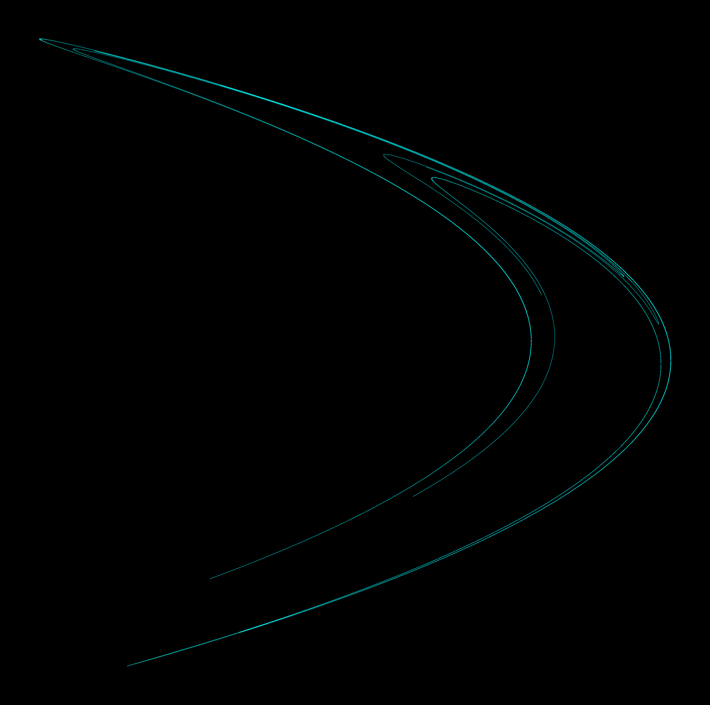
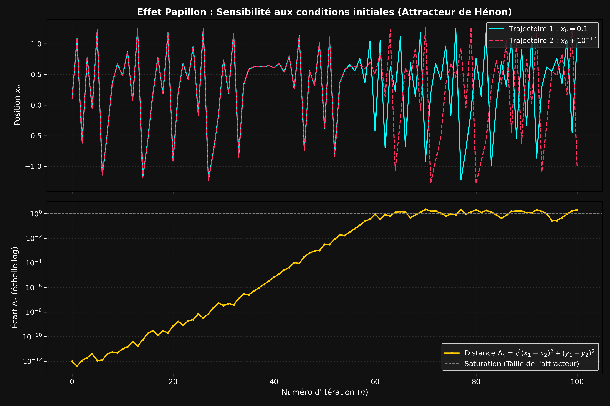
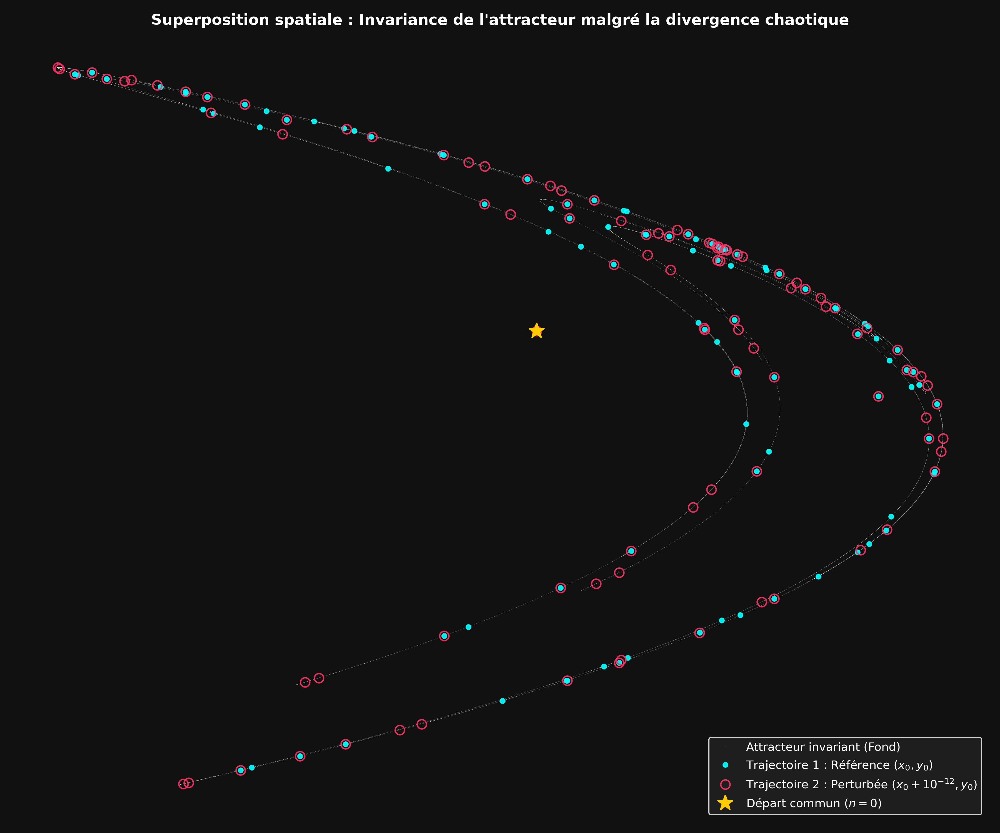
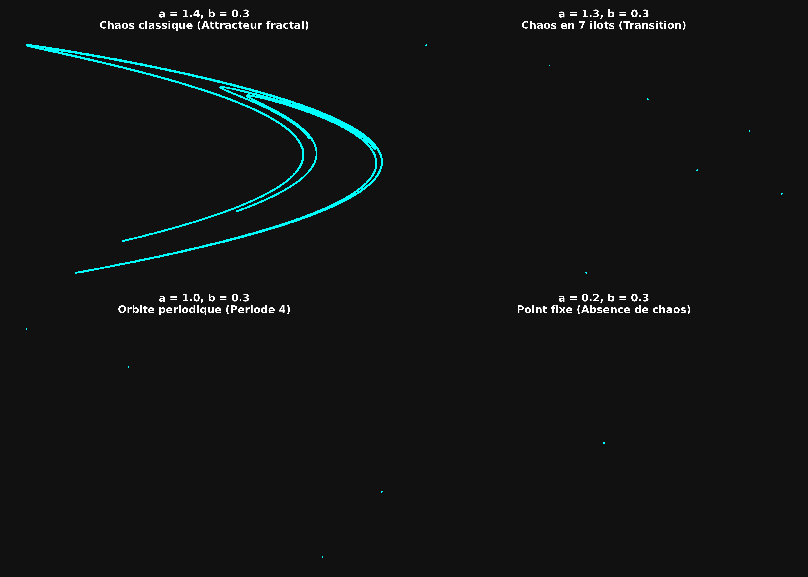

# Étude Numérique et Simulation Haute Performance de l'Attracteur de Hénon (C / Python)

Exploration approfondie du chaos déterministe, de la sensibilité aux conditions initiales, des crises de bifurcation et de leurs origines astrophysiques, propulsée par un moteur de calcul en **C (norme IEEE 754)** optimisé au niveau des registres matériels et une chaîne de visualisation **Python (NumPy / Matplotlib)** en lecture binaire *Zero-Copy*.

---

## 1. Genèse Historique : Comment l'Observation des Astres a mené à l'Équation de Hénon

### A. De Newton à Poincaré : La brisure du déterminisme céleste
Depuis Isaac Newton, la mécanique céleste sait résoudre de manière exacte et analytique le **problème à 2 corps** : une planète isolée gravitant autour d'une étoile (comme le couple Terre-Soleil) décrit une ellipse parfaite, immuable et prévisible à l'infini. Cependant, dès la fin du XIXe siècle, le mathématicien français **Henri Poincaré** démontre qu'il suffit d'ajouter un troisième astre (**problème à 3 corps**, tel que le système Soleil-Terre-Lune) pour qu'il n'existe plus aucune formule analytique exacte donnant la position des corps à tout instant : les trajectoires deviennent inextricables.

Dans les années 1960, l'astrophysicien français **Michel Hénon** (Observatoire de Nice) et l'astronome américain **Carl Heiles** s'attaquent à un problème d'une tout autre échelle : **comment se déplace une étoile individuelle à l'intérieur d'une galaxie ?**
Une galaxie contenant des centaines de milliards d'étoiles, il est impossible de calculer l'attraction de chaque astre un par un. Les astrophysiciens modélisent alors la galaxie entière comme un immense « bol gravitationnel » lisse (un potentiel gravitationnel moyen) dans lequel voyage une étoile solitaire.

Or, un mystère astronomique persistait : selon les lois classiques de la physique (conservation de l'énergie totale et conservation du moment cinétique autour de l'axe galactique), les étoiles proches de notre Soleil devraient présenter des vitesses réparties dans toutes les directions permises. Pourtant, les observations au télescope montraient que les étoiles restaient sagement confinées dans un volume restreint, comme si une « troisième loi cachée » (appelée la **troisième intégrale du mouvement**) les guidait sur des rails invisibles.

### B. L'astuce géométrique de la « Section de Poincaré » (1964)
Pour vérifier si cette troisième loi cachée existait vraiment, Hénon et Heiles simulent par ordinateur l'orbite 3D d'une étoile dans une galaxie. Mais suivre une trajectoire continue en trois dimensions pendant des milliards d'années dessine une pelote de laine totalement illisible. En 1964, ils utilisent alors une méthode géométrique redoutable : la **section de Poincaré**.

Plutôt que de regarder toute la boucle 3D de l'étoile (qui monte au-dessus du disque galactique, redescend, traverse l'équateur, etc.), on imagine que le plan équatorial de la galaxie est une **feuille de papier géante** :
1. L'étoile voyage librement dans l'espace 3D.
2. À chaque fois qu'elle **transperce la feuille de papier**, on allume un point aux coordonnées exactes de l'impact $(x_n, y_n)$, puis on attend son prochain passage pour allumer le point suivant $(x_{n+1}, y_{n+1})$.

Les résultats de 1964 provoquent un choc scientifique en révélant trois comportements selon l'énergie (la vitesse) de l'étoile :
* **À basse énergie (étoiles calmes) :** Les impacts successifs dessinent sur la feuille des courbes fermées parfaites. L'étoile est sur un rail prévisible ; la « troisième intégrale » semble tenir bon.
* **À énergie moyenne :** Les courbes se brisent soudainement pour former une chaîne d'**îlots isolés**.
* **À haute énergie (étoiles rapides) :** Le rail explose. Les impacts successifs d'une seule et même étoile remplissent la feuille d'un nuage de points totalement aléatoire : **le mouvement gravitationnel de l'étoile est devenu chaotique**.

### C. Le verrou informatique de 1976 et le coup de génie algébrique d'Hénon
En 1976, Michel Hénon cherche à observer au microscope la structure intime de ces régions chaotiques et des « attracteurs étranges » (comme celui découvert par Edward Lorenz en 1963 pour expliquer l'imprévisibilité de la météo). Mais il se heurte à un obstacle matériel majeur : **la lenteur des ordinateurs des années 1970**.

Pour connaître le point d'impact suivant $(x_{n+1}, y_{n+1})$ sur la feuille de papier à partir du point $(x_n, y_n)$, l'ordinateur devait résoudre pas à pas des systèmes d'équations différentielles complexes (via l'algorithme de Runge-Kutta) tout au long du voyage 3D de la particule. Calculer quelques milliers d'impacts prenait des heures de calcul, et l'accumulation des erreurs d'arrondi finissait par brouiller l'image, rendant impossible tout zoom profond sur la géométrie du chaos.

Le coup de génie de Michel Hénon en 1976 consiste à **supprimer complètement le voyage en 3D entre deux traversées de la feuille de papier**. Il se pose une question purement géométrique : *« Que fait réellement la physique (la gravité ou la convection atmosphérique) à un nuage de points entre l'impact $n$ et l'impact $n+1$ ? Elle étire l'espace, le plie sur lui-même, et le contracte. »*

Il remplace alors des milliers d'étapes d'intégration différentielle par une simple formule algébrique directe qui calcule instantanément l'impact $(x_{n+1}, y_{n+1})$ à partir de $(x_n, y_n)$. Grâce à cette rapidité de calcul foudroyante, il génère des millions de points et révèle pour la première fois au monde la **structure fractale en mille-feuille** des attracteurs étranges.

---

## 2. Modèle Mathématique et Anatomie de l'Attracteur

L'application de Hénon (*Hénon map*) est un système dynamique discret bidimensionnel non linéaire défini par la récurrence :

$$\begin{cases} x_{n+1} = 1 - a x_n^2 + y_n \\ y_{n+1} = b x_n \end{cases}$$

Chaque terme de cette équation joue un rôle mécanique précis dans la fabrication du chaos :
1. **L'étirement et le pliage non linéaire ($1 - ax_n^2$) :** Le terme quadratique $-ax_n^2$ agit comme un mur élastique courbe. Il étire les distances entre les points proches (ce qui crée l'instabilité et l'Effet Papillon) puis replie la trajectoire sur elle-même pour l'empêcher de partir tout droit vers l'infini.
2. **La contraction dissipative ($bx_n$) :** Le déterminant de la matrice jacobienne de la transformation vaut $\vert{}J\vert{} = \vert{}-b\vert{} = \vert{}b\vert{}$. Pour $\vert{}b\vert{} < 1$ (canoniquement $b = 0.3$), toute surface de l'espace des phases est multipliée par $0.3$ à chaque itération. Le système perd du volume : les trajectoires sont aspirées vers un objet géométrique d'aire nulle mais composé d'une infinité de feuillets superposés (dimension fractale de Hausdorff $D_H \approx 1.26$) appelé **attracteur étrange**.



---

## 3. Architecture Logicielle & Optimisations Bas Niveau (HPC)

Pour simuler $N = 10\,000\,000$ d'itérations et explorer les transitions de phase sans subir la lenteur d'interprétation de Python ni le goulot d'étranglement des conversions texte, le projet adopte une architecture hybride C / Python :

### A. Moteur de calcul C (`src/henon_solver.c`)
* **Compilation native (`-O3 -march=native`) :** Génère un code machine ciblant spécifiquement l'architecture du processeur hôte, maintenant les coordonnées $(x, y)$ et les paramètres $(a, b)$ directement dans les registres matériels 64 bits à virgule flottante (`xmm0`, `xmm1`) sans aller-retour vers la RAM pendant le calcul pur.
* **Multiplication scalaire directe (`x * x`) :** Remplacement de la fonction générique `pow(x, 2)` de `<math.h>` (qui évalue des séries logarithmiques et exponentielles lourdes en une centaine de cycles) par l'instruction matérielle directe `vmulsd` (~3 à 4 cycles d'horloge).
* **Séparation de boucles (*Loop Splitting* pour le *Burn-in*) :** Une condition initiale telle que $(0.1, 0.1)$ ne se trouve pas sur l'attracteur mais dans son bassin d'attraction. Pour éliminer les $1\,000$ premières itérations transitoires (le « temps de chauffe » avant que le point ne tombe sur son régime permanent) sans ralentir le processeur, le code sépare l'exécution en deux boucles `for` successives. Cela évite d'imposer au prédicteur de branchement (*Branch Predictor*) du CPU l'évaluation d'un test `if (i >= 1000)` (instructions `cmp` + `jge`) dix millions de fois dans la boucle principale.
* **Coupe-circuit anti-explosion (Norme IEEE 754) :** Si les paramètres $(a, b)$ dépassent le seuil de stabilité, $x_n$ diverge très vite vers $-\infty$. Dès que $\vert{}x\vert{}$ dépasse la capacité maximale d'un `double` 64 bits ($\approx 1.79 \times 10^{308}$), le calcul `x * x` produit un dépassement de capacité (*Overflow* $\to$ `inf`), puis l'addition suivante génère des valeurs indéterminées `NaN` (*Not a Number*). Le coupe-circuit `if (x > 10.0 || x < -10.0 || y > 10.0 || y < -10.0) break;` à court-circuit logique interrompt instantanément l'acquisition dès que la trajectoire quitte la boîte de stabilité.
* **Flux binaire brut (`fwrite`) :** Au lieu de convertir les nombres flottants en chaînes de caractères ASCII via `fprintf` (extrêmement coûteux en cycles CPU et en taille de fichier), le moteur copie directement les 8 octets IEEE 754 de chaque `double` en mémoire vers le descripteur de fichier binaire `.bin`.

### B. Pipeline de visualisation Python *Zero-Copy* (`scripts/`)
* **Chargement direct (`np.fromfile`) :** Les fichiers binaires de 160 Mo sont projetés directement sous forme de tableaux C contigus (`dtype=np.float64`) en une fraction de seconde.
* **Désentrelacement par *Strided Slicing* :** L'extraction des coordonnées $x$, $y$ ou des distances $\Delta_n$ s'effectue via des vues mémoire à pas constant (`data[0::2]`, `data[1::2]`, ou `data[4::5]`), manipulant uniquement les pointeurs d'adresse et le pas d'incrémentation (*stride*) de NumPy sans jamais dupliquer les tableaux en mémoire vive.

---

## 4. Analyse Physique Approfondie et Résultats Expérimentaux

### A. L'Effet Papillon et l'Horizon de Lyapunov (`assets/henon_divergence.png`)
Pour quantifier la sensibilité aux conditions initiales, deux simulations sont lancées simultanément depuis $(x_0, y_0) = (0.1, 0.1)$, la seconde subissant une perturbation initiale infime de $\varepsilon = 10^{-12}$ sur son abscisse ($x_2(0) = x_1(0) + 10^{-12}$). À chaque itération $n$, la distance euclidienne $\Delta_n = \sqrt{(x_1 - x_2)^2 + (y_1 - y_2)^2}$ est mesurée.



1. **La phase de croissance exponentielle ($0 \le n \le 60$) :** Sur un graphique à axe vertical logarithmique, la courbe d'écart monte en ligne droite (avec des oscillations locales dues aux zones d'étirement et de pliage du boomerang). Une droite sur une échelle logarithmique est la signature mathématique d'une **explosion exponentielle** de la forme $\Delta_n \approx \varepsilon \cdot e^{\lambda n}$, où la pente $\lambda \approx 0.42$ est l'**exposant de Lyapunov** du système.
2. **Le plateau de saturation ($n > 60$) :** À partir de la 60e itération, la courbe cesse de monter et oscille horizontalement autour de $\Delta_n \approx 10^0 = 1$. Pourquoi l'écart ne grandit-il pas jusqu'à l'infini ? Parce que les deux points sont **prisonniers de l'attracteur**, qui est une boîte fermée d'environ $2.5$ unités de large ($x \in [-1.5, 1.5]$). La distance entre les deux trajectoires ne peut matériellement pas dépasser la taille du boomerang lui-même. À ce stade, la perte d'information initiale est totale : il est devenu impossible de prédire la position du point.

### B. Le Paradoxe du Chaos : Imprévisibilité Individuelle vs Invariance Globale (`assets/henon_superposition.png`)
Comme la suite de Hénon est un système à temps discret, le point ne glisse pas en continu : il se « téléporte » d'un bout à l'autre du boomerang à chaque itération. La superposition des 100 premiers impacts de la Trajectoire 1 (disques pleins cyan) et de la Trajectoire 2 (anneaux creux rouges) sur le fond gris de l'attracteur met en lumière trois phénomènes physiques majeurs :



1. **La phase transitoire et le pouvoir d'attraction (L'étoile jaune) :** Le point de départ commun $(0.1, 0.1)$ à $n = 0$ (étoile jaune au centre) flotte au milieu du vide noir, complètement en dehors des lignes de l'attracteur. Pourtant, dès l'itération $n = 1$ (dans le coude à droite), le système est aspiré sur le rail blanc et ne le quitte plus jamais. Le vide central constitue le *bassin d'attraction*, et le boomerang est la variété invariante finale.
2. **La fenêtre de prédictibilité ($n < 55$, les « cibles ») :** Sur une grande partie du boomerang, on observe des disques cyan parfaitement centrés à l'intérieur des anneaux rouges. Pendant les ~55 premières itérations, bien que l'écart $\Delta_n$ grandisse en coulisses (de $10^{-12}$ à $10^{-3}$), il reste inférieur à la taille d'un pixel à l'écran : à court terme, les deux trajectoires semblent confondues.
3. **Divorce individuel mais invariance globale ($n > 60$, anneaux vides et points isolés) :** Vers les pointes externes et sur les courbes intérieures apparaissent des anneaux rouges totalement vides (sans point cyan) et des points cyan solitaires (sans anneau rouge). Ce sont les itérations $n > 60$ : les deux trajectoires ont totalement divorcé et atterrissent aux quatre coins opposés de la figure. **Pourtant, 100 % des anneaux rouges vides et 100 % des points cyan isolés tombent pile sur le rail blanc de l'attracteur.** La position exacte d'un point à l'instant $n$ est imprévisible, mais la géométrie globale du système est indestructible.

### C. L'Influence des Paramètres $(a, b)$ : Du Point Fixe à la Crise Intérieure (`assets/henon_regimes.png`)
En fixant $b = 0.3$ et en faisant varier le paramètre de non-linéarité $a$ (après élimination de $1\,000$ itérations de *burn-in* pour effacer la traînée de chute initiale), on observe la naissance et les mutations du chaos :



#### 1. Le Point Fixe ($a = 0.2, b = 0.3$) — La mort du mouvement
La force de pliage $a$ est trop faible face au frottement dissipatif $b$. Après quelques rebonds, le système s'écrase et s'immobilise définitivement sur une coordonnée d'équilibre unique.

#### 2. L'Orbite Périodique Pure ($a = 1.0, b = 0.3$) — La mort de l'Effet Papillon
Dans ce régime, le point saute indéfiniment entre **exactement 4 coordonnées mathématiques fixes** (orbite de période 4 issue de la cascade de doublement de période de Feigenbaum).
* Si l'on zoome un million de fois sur l'un de ces 4 points, on ne voit toujours qu'un seul point infiniment fin.
* Si l'on lance deux trajectoires avec un écart initial de $10^{-12}$, la distance $\Delta_n$ diminue jusqu'à tomber à $0$ : le système oublie sa condition initiale et force tout le monde sur le même rail à 4 arrêts. L'exposant de Lyapunov est **négatif** ($\lambda < 0$). Il n'y a aucun chaos.

#### 3. Le Chaos Confiné en 7 Îlots ($a = 1.3, b = 0.3$) — Périodique au télescope, Chaotique au microscope
Ce régime ne représente ni une explosion vers l'infini, ni une orbite périodique simple : c'est un état hybride fascinant appelé **chaos confiné** (ou attracteur semi-périodique), qui se divise en deux échelles d'observation :
* **À l'échelle macroscopique (Périodique) :** Le système est parfaitement stable et captif. L'ordre de visite des 7 régions est strictement prévisible et cyclique : le point saute de l'îlot $1 \to 2 \to 3 \to 4 \to 5 \to 6 \to 7 \to 1$.
* **À l'échelle microscopique (Chaotique) :** Lorsque le point revient sur l'îlot 1 au bout de 7 itérations, **il ne retombe jamais exactement au même endroit**. Si l'on zoome fortement sur l'un de ces 7 îlots, on découvre qu'il n'est pas constitué d'un point unique, mais qu'il possède sa propre structure fractale interne (c'est un « mini-boomerang »).
* **L'Effet Papillon y est pleinement actif ($\lambda > 0$) :** Deux trajectoires séparées de $10^{-12}$ au départ resteront toujours synchronisées sur le même *numéro* d'îlot au même instant, mais leurs positions exactes **à l'intérieur** de chaque îlot vont diverger exponentiellement jusqu'à occuper des bords opposés de l'îlot.

#### 4. L'Attracteur Canonique ($a = 1.4, b = 0.3$) — La Fusion par « Crise Intérieure »
Quelle est la différence physique entre les 7 îlots ($a = 1.3$) et le grand boomerang continu ($a = 1.4$) ? C'est un phénomène appelé **crise intérieure** :
* À mesure que l'on augmente $a$ de $1.3$ vers $1.4$, le mur élastique du système devient plus violent. En conséquence, les 7 mini-attracteurs (les îlots) gonflent et s'étirent dans l'espace.
* Autour d'un seuil critique ($a \approx 1.32$), les îlots deviennent si larges qu'ils finissent par se toucher et percuter les frontières instables qui les séparaient. Leurs barrières volent en éclats et les 7 îlots **fusionnent**.
* À $a = 1.4$, le confinement cyclique a disparu : les 7 îlots sont devenus une seule et unique autoroute fractale continue sur laquelle le point circule d'un bout à l'autre de manière imprévisible.

#### 5. Au-delà de $a \approx 1.43$ — La « Crise de Frontière » et l'Explosion vers l'Infini
La frontière entre le chaos stable et la mort du système est extrêmement abrupte. Si l'on pousse $a$ à $1.43$ ou $1.5$ (pour $b = 0.3$), le boomerang grandit au point de percer la frontière de son propre bassin d'attraction. Au bout de quelques itérations, le point s'échappe de la boîte, dépasse $-2$, puis $-10$, et plonge vers $-\infty$ à une vitesse vertigineuse (déclenchant immédiatement le coupe-circuit de sécurité du code C).

---

## 5. Répercussions Concrètes sur les Astres et l'Architecture de l'Univers

Les régimes mathématiques exacts générés par ce programme gouvernent aujourd'hui l'évolution réelle des galaxies, des astéroïdes et des planètes :

### A. L'Orbite Périodique ($a = 1.0$) et les Îlots ($a = 1.3$) $\longrightarrow$ Les Résonances Orbitales et les Volcans de Io
Lorsqu'un système gravitationnel se fige sur des points périodiques ou des îlots de stabilité, cela correspond en astronomie aux **résonances gravitationnelles** :
* **Les lunes de Jupiter (Io, Europe et Ganymède) :** Ces trois lunes sont piégées dans une résonance exacte $4:2:1$. À chaque fois que Ganymède fait 1 tour de Jupiter, Europe en fait exactement 2 et Io en fait 4. Elles sont enfermées dans des « îlots de stabilité » qui les empêchent de dériver. Mais comme leurs orbites se croisent à des rythmes réguliers, elles se tirent mutuellement dessus toujours aux mêmes endroits : cela tord et malaxe l'intérieur rocheux de la lune Io par effet de marée, chauffant son cœur jusqu'à en faire l'astre le plus volcanique du Système Solaire.
* **Les galaxies spirales barrées (comme notre Voie Lactée) :** Au centre de notre galaxie, des milliards d'étoiles sont piégées dans ces îlots d'orbites résonnantes allongées, formant la structure même de la grande « barre » lumineuse centrale.

### B. Le Coupe-Circuit d'Explosion ($a > 1.43$) $\longrightarrow$ Les Lacunes de Kirkwood et la Chute des Météorites sur Terre
La sécurité d'échappement vers l'infini codée dans le solveur correspond exactement au mécanisme qui envoie des météorites sur la Terre :
* Dans la ceinture d'astéroïdes située entre Mars et Jupiter, l'immense masse de Jupiter joue le rôle du paramètre non linéaire $a$.
* À certaines distances très précises du Soleil (appelées **lacunes de Kirkwood**, par exemple là où un astéroïde fait exactement 3 tours du Soleil quand Jupiter en fait 1), l'attraction répétée de Jupiter fait basculer l'équation orbitale dans le régime explosif ($a > 1.43$).
* **Conséquence physique :** L'orbite de l'astéroïde devient follement chaotique, s'étire violemment, et l'astéroïde est **éjecté de la ceinture** — soit propulsé hors du Système Solaire, soit précipité vers l'intérieur sur une trajectoire qui croise l'orbite de la Terre. C'est la source principale des météorites qui frappent notre planète.

### C. L'Effet Papillon ($\varepsilon = 10^{-12}$) $\longrightarrow$ Le Destin Chaotique du Système Solaire (Travaux de Jacques Laskar)
L'astronome français **Jacques Laskar** (Observatoire de Paris) a appliqué le test de divergence des trajectoires aux 8 planètes de notre Système Solaire sur des supercalculateurs :
* **Résultat :** Notre Système Solaire est globalement chaotique, avec un temps de Lyapunov d'environ **5 millions d'années**.
* Concrètement, si l'on décale la position de la Terre de seulement **15 mètres** aujourd'hui (notre perturbation $\varepsilon$), cet écart est multiplié par 10 tous les 10 millions d'années.
* De même que les trajectoires cyan et rouge du simulateur deviennent totalement décorrélées après l'itération $n = 60$, il est **mathématiquement impossible de prédire la position exacte de la Terre sur son orbite au-delà de 100 millions d'années**.
* **Le paradoxe de la survie et le risque de collision :** Tout comme les points de Hénon restent sur le rail du boomerang après avoir divergé, l'orbite de la Terre reste globalement stable malgré cette imprévisibilité de position. Cependant, les simulations à très long terme (sur quelques milliards d'années) montrent que dans environ **1 % des cas**, l'orbite de la petite planète Mercure se déforme tellement par chaos (sous l'influence de Jupiter) qu'elle finit par dérailler et entrer en collision avec Vénus ou la Terre !

---

## 6. Benchmark HPC & Rétro-Ingénierie Matérielle ($N = 10\,000\,000$)

Pour démontrer la supériorité d'un moteur compilé bas niveau face à un langage interprété, un benchmark rigoureux exécute $10\,000\,000$ d'itérations en C (`src/benchmark.c`, horloge POSIX `<time.h>`) et en Python pur (`scripts/benchmark_python.py`).

### A. Environnement Matériel de Test
* **Processeur (CPU) :** **AMD Ryzen 9 5900X** (Architecture Zen 3, gravure 7 nm, 12 cœurs / 24 threads, fréquence Boost jusqu'à **4.8 GHz**, 64 Mo de cache L3).
* **Compilateur & Cible :** `gcc -Wall -Wextra -O3 -march=native` sous Linux Ubuntu (WSL2), activant automatiquement le jeu d'instructions matériel **`znver3`** (unités vectorielles 256 bits et FMA3).
* **Précaution contre le *Dead Code Elimination* (`-O3`) :** En C, si une boucle calcule 10 millions d'étapes sans que le résultat final $(x, y)$ ne soit jamais lu après la boucle, l'optimiseur `-O3` de GCC détecte que le calcul est sans effet de bord et supprime purement et simplement la boucle (affichant `0.0000 s`). L'affichage de l'état final `(x, y)` après l'arrêt du chronomètre force le processeur à exécuter réellement les $10^7$ itérations dans ses registres.

### B. Tableau Comparatif des Performances ($10^7$ itérations)

| Implémentation | Temps d'exécution | Temps / itération | Débit / Performance | État final $(x_N, y_N)$ |
| :--- | :---: | :---: | :---: | :---: |
| **C — CPU Pur (Registres `xmm`)** | **0.0211 s** | **2.11 ns** | **2.37 GFLOPS** (Speedup **×18.5**) | $(0.9194, -0.1610)$ |
| **C — CPU + I/O Binaire (160 Mo)** | **0.2734 s** | 27.34 ns | **634 Mo/s** vers SSD local | $(0.9194, -0.1610)$ |
| **Python 3 — CPU Pur (Boucle native)** | **0.3900 s** | 39.00 ns | Référence (×1.0) | $(1.2231, 0.0331)$ |

### C. Analyse Micro-Architecturale Approfondie

#### 1. Rétro-ingénierie de la fréquence et limite physique du silicium ($2.11\text{ ns}$ / itération)
Le Ryzen 9 5900X boucle $10\,000\,000$ d'itérations en **$0.0211\text{ seconde}$** ($21.1\text{ ms}$), soit exactement **$2.11\text{ nanosecondes}$ par itération**.
Dans la récurrence de Hénon, l'étape $n+1$ dépend obligatoirement du résultat de l'étape $n$ ($x_{n+1} = 1 - ax_n^2 + y_n$). Le processeur subit une **chaîne de dépendance matérielle stricte** (*Loop-Carried Dependency*) :
* Un seul cœur sur les 12 du Ryzen 9 5900X peut travailler sur cette trajectoire (impossible de paralléliser le futur avant d'avoir calculé le présent).
* À chaque tour de boucle, le chemin critique dans l'unité à virgule flottante (FPU) est incompressible : il faut d'abord calculer $x \times x$ (instruction assembleur `vmulsd`, latence de **3 à 4 cycles d'horloge**), puis évaluer $1 - a(x^2) + y$ via une instruction fusionnée FMA (`vfnmadd213sd`) et une addition (latence de **4 à 5 cycles d'horloge**).
* Un tour de boucle exige donc un minimum physique incompressible de **8 à 10 cycles d'horloge**. Or, sur un cœur de Ryzen 9 5900X cadencé à $\sim 4.75\text{ GHz}$ en Boost monocœur, **10 cycles d'horloge durent exactement $2.11\text{ nanosecondes}$** ($\frac{10\text{ cycles}}{4.75 \times 10^9\text{ Hz}} = 2.105\text{ ns}$). Cela prouve mathématiquement que le code C a atteint la **vitesse maximale absolue permise par la physique des transistors** du processeur (soit un débit scalaire de $5\text{ FLOPs} / 2.11\text{ ns} = \mathbf{2.37\text{ GFLOPS}}$ sur un seul fil d'exécution).

#### 2. Le mur des Entrées/Sorties (*I/O Wall* : $634\text{ Mo/s}$ en circuit local)
Lorsque l'on active l'écriture du fichier binaire `henon_points.bin` de **160 Mo** ($10^7 \text{ points} \times 2 \text{ coordonnées} \times 8\text{ octets}$), le temps passe de $0.0211\text{ s}$ à **$0.2734\text{ s}$**.
* Le temps pur consacré à l'écriture des données est donc de $0.2734 - 0.0211 = 0.2523\text{ seconde}$, ce qui représente **$92.3\text{ \%}$ du temps total d'exécution**.
* Ce transfert s'effectue intégralement en circuit fermé sur la carte mère (Registres CPU $\to$ Tampon RAM `FILE*` et Page Cache du noyau Linux $\to$ lignes PCIe $\to$ SSD NVMe local au sein du disque virtuel `ext4.vhdx` de WSL2), atteignant un débit soutenu de $\frac{160\text{ Mo}}{0.2523\text{ s}} \approx \mathbf{634\text{ Mo/s}}$.
* Même pénalisé par l'écriture de 160 Mo sur le disque, le moteur C ($0.2734\text{ s}$) reste plus rapide que Python ($0.3900\text{ s}$) qui ne sauvegarde pourtant aucune donnée !

#### 3. L'Effet Papillon numérique entre C et Python : FMA vs Non-FMA
Un détail fondamental apparaît dans le tableau de résultats : à la $10\,000\,000^{\text{e}}$ itération, le moteur C termine au point **$(0.9194, -0.1610)$** tandis que Python termine au point **$(1.2231, 0.0331)$**, alors que la formule mathématique, le point de départ $(0.1, 0.1)$ et le type flottant 64 bits (`double` IEEE 754) sont strictement identiques.

Cette différence est une manifestation directe de l'Effet Papillon déclenchée par l'architecture du processeur :
* Grâce aux drapeaux `-O3 -march=native`, GCC utilise les instructions matérielles **FMA (*Fused Multiply-Add*)** du Ryzen 9 5900X. Une instruction FMA calcule $a \times x^2 + y$ en une seule opération matérielle atomique avec **un seul arrondi** au 53e bit de la mantisse.
* Python, à l'inverse, n'utilise pas le FMA dans sa boucle interprétée : il calcule d'abord la multiplication (1er arrondi matériel à $\sim 10^{-16}$), puis l'addition (2e arrondi matériel à $\sim 10^{-16}$).
* Cette infime différence d'arrondi de $\varepsilon \approx 10^{-16}$ (le *machine epsilon*) dès la toute première itération est amplifiée exponentiellement par l'exposant de Lyapunov ($\lambda \approx 0.42$). Au bout d'environ $n \approx \frac{\ln(1 / 10^{-16})}{0.42} \approx 85\text{ itérations}$, la trajectoire C et la trajectoire Python ont totalement divergé, tout en continuant toutes deux à dessiner exactement le même attracteur de Hénon !

---

## 7. Structure du Dépôt et Commandes de Reproduction

```text
henon-chaos-hpc/
├── assets/                     # Planches scientifiques haute résolution (300 DPI)
│   ├── henon_attractor.png     # Attracteur étrange complet (10M d'itérations)
│   ├── henon_divergence.png    # Courbe semi-log de divergence (Exposant de Lyapunov)
│   ├── henon_superposition.png # Superposition spatiale de 2 trajectoires (Effet Papillon)
│   └── henon_regimes.png       # Grille 2x2 des 4 régimes de bifurcation (a = 1.4, 1.3, 1.0, 0.2)
├── data/                       # Fichiers binaires bruts IEEE 754 (ignorés par Git via .gitignore)
├── include/
│   └── henon_solver.h          # Prototypes et constantes du moteur C
├── src/
│   ├── henon_solver.c          # Solveur HPC (Loop splitting, coupe-circuit IEEE 754, fwrite)
│   ├── benchmark.c             # Chronométrage POSIX <time.h> (CPU pur vs CPU + I/O)
│   └── main.c                  # Point d'entrée principal
├── scripts/
│   ├── plot_henon.py           # Rendu de l'attracteur global
│   ├── plot_divergence.py      # Rendu de la sensibilité aux conditions initiales
│   ├── plot_superposition.py   # Rendu de l'invariance globale vs divergence locale
│   ├── plot_regimes.py         # Rendu de la planche comparative 2x2 des régimes
│   └── benchmark_python.py     # Benchmark comparatif en Python pur (10M d'itérations)
├── Makefile                    # Compilation automatisée (-O3 -march=native)
└── README.md                   # Rapport d'ingénierie complet
# 1. Compilation du moteur C (binaire optimisé généré dans bin/henon_sim)
make

# 2. Génération des fichiers binaires (.bin) et lancement du Benchmark C
./bin/henon_sim

# 3. Lancement du Benchmark comparatif en Python pur
python3 scripts/benchmark_python.py

# 4. Génération des 4 planches graphiques dans le dossier assets/
python3 scripts/plot_henon.py
python3 scripts/plot_divergence.py
python3 scripts/plot_superposition.py
python3 scripts/plot_regimes.py
